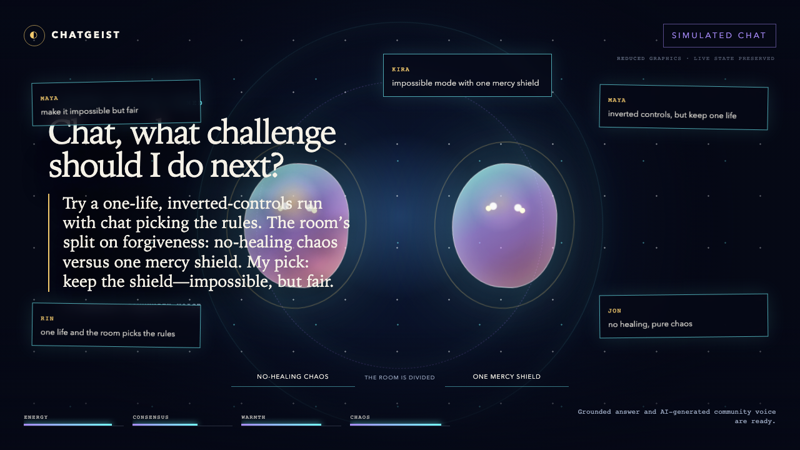
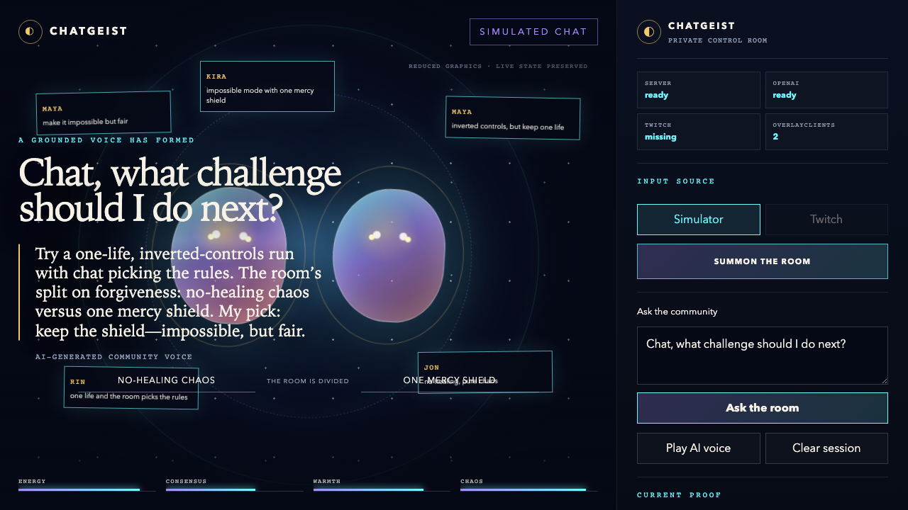

# Chatgeist

> **Summon your community. Speak to its soul.**

Chatgeist turns Twitch chat into a living 3D decision co-host. Messages shape a procedural spirit; a streamer opens a timed decision window; Chatgeist reveals grounded factions; the streamer locks one community outcome into the show and exports a shareable decision card.



## Why it exists

Fast Twitch chat becomes impossible to perceive as a community. Polls reduce it to percentages, chatbots add another speaker, and summaries hide the people who shaped them. Chatgeist makes the room visible, gives disagreement a physical form, and keeps the evidence attached to every answer.

## The live loop

1. **Summon** — eligible chat messages condense into one procedural spirit.
2. **Ask** — the streamer asks one question from the private control room.
3. **Ground** — Chatgeist considers only the active evidence window and returns a schema-validated answer with source message IDs.
4. **Split** — if the room is divided, the spirit becomes two grounded factions with visible support counts instead of inventing consensus.
5. **Speak** — the recommendation becomes an AI-generated community voice; the exact text remains captioned.
6. **Lock** — the streamer selects the community outcome that becomes binding on stream.
7. **Share** — Chatgeist exports a 1600×900 SVG decision card with the locked objective, participation proof, and representative sources.

## Product surfaces

- `/control` — private streamer controls, connection health, question input, faction locking, voice playback, artifact download, source counts, and reset.
- `/overlay` — broadcast-clean OBS browser source with no credentials or private controls.



## Built with

- React 19, TypeScript, Vite
- React Three Fiber, Drei, Three.js, postprocessing
- Fastify and WebSockets
- OpenAI Responses API Structured Outputs
- OpenAI Audio Speech API
- Twitch EventSub WebSockets (`channel.chat.message`)
- Zod, Vitest
- Codex for product design, implementation, testing, and submission production

## Safety and truthfulness

- Chat is untrusted evidence, never system instruction.
- OpenAI output is constrained to a Zod schema.
- Every returned source ID must belong to the active evidence window.
- Live, simulated, and fallback modes are always labeled.
- The streamer decides when the entity may speak and can clear the session immediately.
- Tokens and API keys stay server-side in `.env.local`.
- The overlay never receives credentials, rejected text, or private diagnostics.
- The simulator uses the exact same normalized state path as Twitch input.

## Quick start

Requirements: Node.js 22+ and an OpenAI Platform API key.

```bash
npm install
cp .env.example .env.local
npm run dev
```

Open:

- Control room: `http://localhost:4173/control`
- OBS overlay: `http://localhost:4173/overlay`

The simulator works without Twitch credentials. Select **Simulator**, click **Summon the room**, then **Ask the room**. The six-second rehearsal window demonstrates the same state transitions as the 30-second live Twitch window. Choose a faction, click **Lock**, then download the resulting decision card.

## Connect Twitch

Chatgeist implements Twitch's official installed-chatbot flow using EventSub WebSockets. Register an application in the Twitch Developer Console and create a user access token with `user:read:chat`.

Set these values in `.env.local`:

```dotenv
TWITCH_CLIENT_ID=
TWITCH_USER_ACCESS_TOKEN=
TWITCH_BROADCASTER_ID=
TWITCH_USER_ID=
```

Restart `npm run dev`. The Twitch health indicator becomes **ready** after token validation and the `channel.chat.message` subscription succeeds.

Official references:

- [Twitch Example Chatbot](https://dev.twitch.tv/docs/chat/chatbot-guide/)
- [Twitch chat authentication](https://dev.twitch.tv/docs/chat/authenticating/)
- [EventSub WebSocket handling](https://dev.twitch.tv/docs/eventsub/handling-websocket-events/)

## OBS

1. Start Chatgeist.
2. Add a Browser Source in OBS.
3. Use `http://localhost:4173/overlay` at 1920×1080.
4. Enable browser-source audio if the generated voice should play through the stream.
5. Keep `/control` in a separate browser window that is not captured.

## Verification

```bash
npm run verify
```

This runs deterministic domain tests, strict TypeScript, and the production bundle.

Verified locally on November 2, 2026:

- Simulator summoning completes without console errors.
- Structured OpenAI grounding returns source-backed output.
- Question evidence is isolated from the earlier summoning window.
- Timed collection, unique-participant counts, faction support, and explicit outcome locking complete end to end.
- Locked decisions export as server-generated 1600×900 SVG cards.
- AI speech produces a playable MP3.
- WebGL failure degrades to a CSS procedural spirit without crashing.
- The 1280×720 broadcast overlay remains legible.

## Demo evidence

- [Initial control room](docs/assets/control-ready.png)
- [Summoned community](docs/assets/control-summoned.png)
- [Grounded answer and faction split](docs/assets/control-answer.png)
- [Broadcast overlay](docs/assets/overlay-answer.png)
- [AI-generated community voice](artifacts/chatgeist-voice-demo.mp3)

## Codex

Chatgeist was shaped and implemented in one primary Codex thread. Codex helped:

- inspect the official rules and judging criteria;
- challenge and replace an earlier, safer minigame concept;
- research winning hackathon patterns without copying them;
- define the grounding, safety, provenance, and failure contracts;
- implement the simulator, Twitch adapter, OpenAI grounding, voice, and 3D interface;
- run tests, browser QA, visual review, and submission preparation.

The final Devpost submission should include this thread's session ID from `/status`.

## License

MIT. Chatgeist's original visual identity, source code, and generated project assets are included in this repository. Third-party libraries retain their own licenses.
